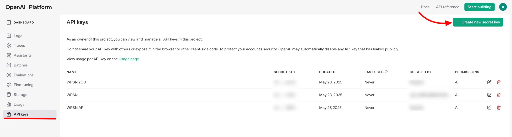
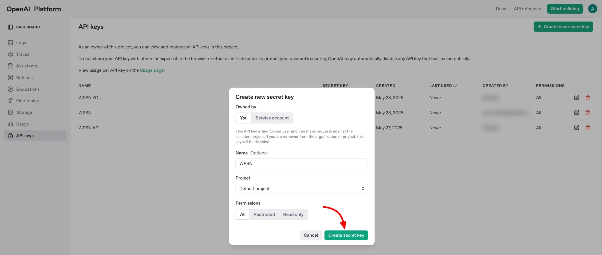
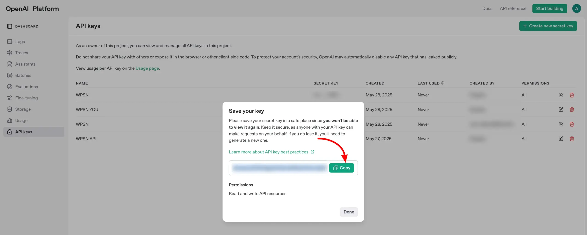
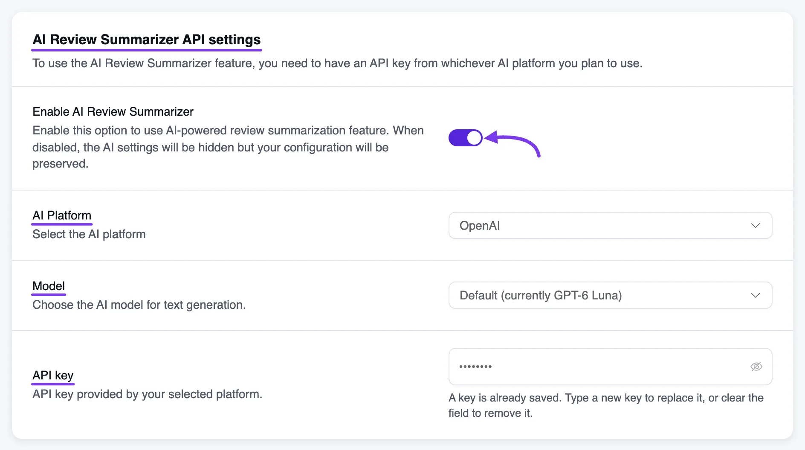
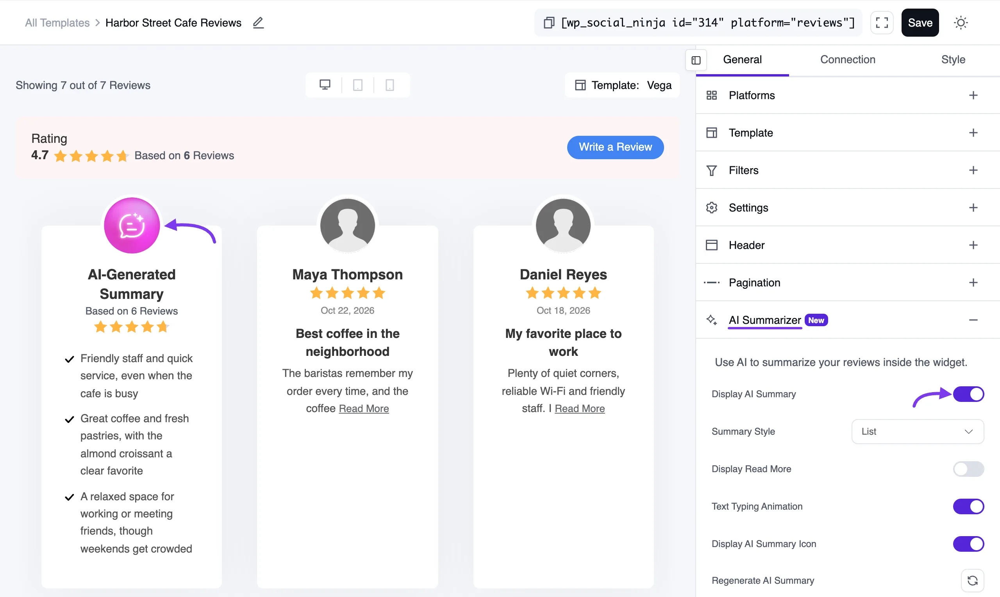

# OpenAI Integration for Review

Got a growing stream of reviews from platforms like Google, Facebook, or Yelp? It’s great to have so much feedback but reading through it all can be overwhelming for your visitors.

That’s where **WP Social Ninja’s integration with OpenAI** comes in.

With just a few steps, you can automatically generate a **concise, AI-written summary** of all your customer reviews. It highlights key sentiments and insights, helping potential customers quickly understand what others love about your business without missing the essence.

In this guide, we’ll show you:

- How to get your **OpenAI API key**

- How to connect OpenAI with **WP Social Ninja**

- How to display **AI-generated summaries** right in your review templates

## **What This Integration Does**

Instead of editing or rewriting individual reviews, WP Social Ninja with **OpenAI** takes a smarter approach:

It analyzes all the reviews fetched from a platform and generates a well-crafted review summary using AI.

This summary is then displayed in your selected **review templates**, making it easier for visitors to quickly understand what your customers are saying.

## **Get Your OpenAI API Key**

To activate this feature, you’ll need an API key from OpenAI. Here's how to get it:

Go to[ OpenAI](https://platform.openai.com/api-keys) and sign in to your account (or create one if you're new). From the left sidebar, click on **API Keys**, then select **Create new secret key** to generate a new key.

A popup will appear prompting you to enter a name for your API key. Simply type in a name that helps you identify it later.

Your new API key will be displayed—copy and save it securely. You'll need it shortly.

## **Connect OpenAI to WP Social Ninja**

Now that you’ve got your API key, let’s connect it to your WordPress site.

- Navigate to your **WordPress dashboard** → **WP Social Ninja → Settings**.

- In the left menu, open **Reviews Platforms** and click **Global Reviews Settings**.

- Scroll down to find the **AI Review Summarizer API settings** section.

Now configure the settings:

- **Enable AI Review Summarizer:** Turn this on.

- **AI Platform:** Select **OpenAI** from the dropdown menu.

- **Model:** Keep the **Default** option, or choose another OpenAI model based on your usage and plan.

- **API Key:** Paste the API key you copied from your OpenAI account.

Click **Save Settings** to apply your changes.

> [!NOTE]
> Models that OpenAI no longer supports aren't offered in the **Model** list. If your saved model is retired, it stays in the list marked as unavailable, and summaries use the **Default** model until you pick another one.

If you'd rather not manage an API key, see [WordPress AI](./wordpress-ai-integration-for-review), which is available on WordPress 7.0 or later.

## Enable AI-Generated Summary in Your Review Template

With the setup complete, you can now choose where to display the AI summary.

- Go to the **Review Template** where you'd like the summary to appear.

- On the **right sidebar**, toggle on the **Display AI Summary** option.

Once enabled, you’ll unlock a few customization options to make your summary stand out:

- **Display AI Summary:** Turn the AI-generated summary on or off.

- **Summary Style:** Choose how the summary appears—**Text** or **List** format.

- **Display Read More:** Adds a “Read More” link for longer summaries.

- **Text Typing Animation:** Adds a typing animation effect for dynamic display.

- **Regenerate AI Summary:** Refresh the summary based on newly collected reviews.

