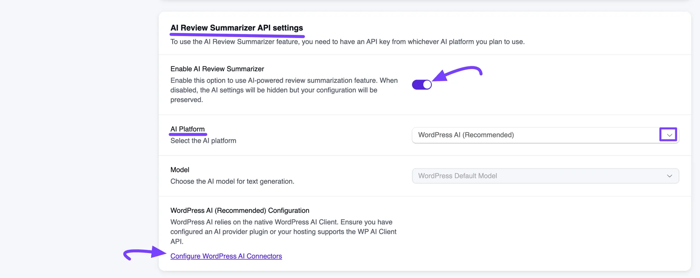
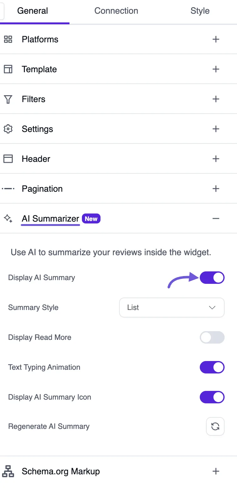

# WordPress AI Integration for Review

Want AI review summaries without managing another API key? If your site runs WordPress 7.0 or later, WP Social Ninja can use the AI service you already connected to WordPress.

> [!NOTE]
> **WordPress AI** for AI review summaries is available in WP Social Ninja Pro.

In this guide, you'll learn how to:

- Check that your site is ready
- Choose **WordPress AI** in WP Social Ninja
- Show the AI summary in a review template

## What This Integration Does

WP Social Ninja reads the reviews from your connected platforms and writes one short summary of them. Your visitors can then see what customers are saying at a glance.

With **WordPress AI**, the request goes through the AI service set up in WordPress. WordPress holds the credentials, so you don't enter an API key in WP Social Ninja.

## What You Need First

Before you start, make sure you have:

- **WordPress 7.0 or later**
- **WP Social Ninja Pro**
- **An AI service connected to WordPress**, either through an AI provider plugin or through your hosting

To check your AI service, go to **Settings → Connectors** in your WordPress dashboard. A connector is the link between WordPress and an AI service. This page lists services such as **Anthropic**, **Google**, and **OpenAI**, each with an **Install** button.

## Choose WordPress AI in WP Social Ninja

Once your site is ready, let's connect it to WP Social Ninja:

1. Go to **WP Social Ninja → Settings**.
2. In the left menu, open **Reviews Platforms** and click **Global Reviews Settings**.
3. Scroll down to the **AI Review Summarizer API settings** section.
4. Turn on **Enable AI Review Summarizer**.
5. Under **AI Platform**, select **WordPress AI (Recommended)**.
6. Click **Save Settings** at the top of the page.

The **Model** field locks to **WordPress Default Model**, so there is nothing to choose. The **API key** field also disappears, because WordPress already holds the credentials.

If you still need to connect an AI service, click **Configure WordPress AI Connectors** in this section. It takes you to the **Connectors** page.

## Show the AI Summary in a Review Template

Next, choose where the summary appears:

1. Open the [review template](../business-reviews/create-template) where you want to show the summary.
2. On the **General** tab, open the **AI Summarizer** section.
3. Turn on **Display AI Summary**.
4. Adjust the other options, then click **Save**.

You can also use these options:

- **Summary Style:** Show the summary as **Text** or as a **List**.
- **Display Read More:** Add a "Read More" link for longer summaries.
- **Text Typing Animation:** Add a typing effect to the summary.
- **Display AI Summary Icon:** Show or hide the small AI icon.
- **Regenerate AI Summary:** Write a new summary from your latest reviews.

## Troubleshooting

**WordPress AI isn't in the AI Platform list.** This option only appears when the WordPress AI Client is available on your site. Update to WordPress 7.0 or later, then check the list again.

**You see "No WordPress AI connector is configured for text generation."** WordPress has no AI service ready to write text. Go to **Settings → Connectors**, set one up, and try again.

**You see "AI summary cannot be enabled because the model is not selected or the API key is missing."** Your AI settings aren't saved yet. Go back to **Global Reviews Settings**, check that **Enable AI Review Summarizer** is on, and click **Save Settings**. The message mentions an API key, but **WordPress AI** doesn't need one.

**You'd rather use your own API key.** You can use [OpenAI](./openai-integration-for-review) or [OpenRouter](./openrouter-integration-for-review) instead.
