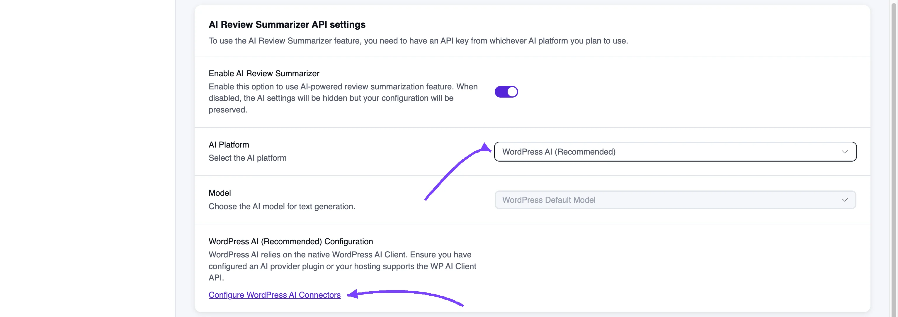

# WordPress AI Integration for Review

WP Social Ninja can write one short summary of all the reviews from a platform or product, so visitors get the highlights at a glance. With **WordPress AI**, those summaries are generated by the AI service you've already set up in WordPress itself. You don't need a separate OpenAI or OpenRouter account, and there's no API key to paste.

::: tip
AI review summaries are a WP Social Ninja **Pro** feature.
:::

## Before You Start

WordPress AI appears as an option only when your site has the WordPress AI Client, which comes with **WordPress 7.0 or later**.

WordPress itself also needs an AI provider. Either install and configure an AI provider plugin, or check that your hosting supports the WordPress AI Client. If WordPress AI doesn't appear in the platform list, update WordPress first.

## Turn On WordPress AI

1. In your WordPress dashboard, go to **WP Social Ninja → Settings**.
2. From the left sidebar, click **Reviews Platforms**, then select **Global Review Settings**.
3. Scroll to the **AI Review Summarizer API settings** section and turn on **Enable AI Review Summarizer**.
4. For **AI Platform**, select **WordPress AI (Recommended)**.
5. The **Model** field shows **WordPress Default Model**. WordPress decides which model runs, based on the provider you've configured, so there's nothing to choose here.
6. In place of the API key field, you'll see a **WordPress AI Configuration** note. Click **Configure WordPress AI Connectors** if you still need to set up a provider in WordPress.
7. Click **Save Settings**.

## Show the Summary in a Template

Once the platform is saved, open the [review template](../business-reviews/create-template) where you want the summary and turn on **Display AI Summary** in the right sidebar. The display options are the same as for the other AI platforms. See [OpenAI Integration](./openai-integration-for-review#enable-ai-generated-summary-in-your-review-template) for the full list.

## Switching From OpenAI or OpenRouter

You can switch at any time. Select **WordPress AI (Recommended)** as the **AI Platform** and save. Your saved API key for the other platform isn't needed while WordPress AI is selected.

> [!NOTE]
> If summaries stop appearing after you switch, make sure an AI provider is configured in WordPress. Without one, WordPress has nothing to send your reviews to.
