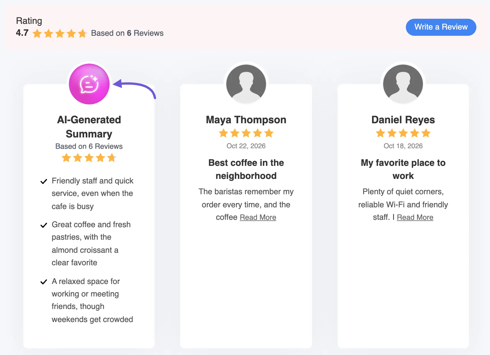

# WordPress AI Integration for Review

Want AI review summaries without managing another API key? If your site runs WordPress 7.0 or later, WP Social Ninja can use the AI service you already connected to WordPress.

> [!NOTE]
> **WordPress AI** for AI review summaries is available in WP Social Ninja Pro.

In this guide, you'll learn how to:

- Check that your site is ready
- Choose **WordPress AI** in WP Social Ninja
- Show the AI summary in a review template

## How WordPress AI Summaries Work

WP Social Ninja scans the reviews from your connected platforms and writes a single, concise summary. This allows your website visitors to see exactly what customers are saying at a glance.

By selecting the WordPress AI integration, the generation request goes directly through the AI service you set up in WordPress. Because WordPress safely holds your credentials, the API key field in WP Social Ninja simply disappears, you don't need to configure it twice.

## Requirement

Before setting up your summaries, ensure your website meets the following requirements:

- **WordPress 7.0** or later is installed.
- **WP Social Ninja Pro** is installed and activated.
- **An active AI service** is connected to WordPress (configured either through an AI provider plugin or your web hosting).

To check your AI service, go to **Settings → Connectors** in your WordPress dashboard. A connector is the link between WordPress and an AI service. This page lists services such as **Anthropic**, **Google**, and **OpenAI**, each with an **Install** button.

## Enabling WordPress AI in Global Settings

Once your site is ready, you need to tell WP Social Ninja to use your core WordPress AI connection.

1. Go to **WP Social Ninja → Settings**.
2. In the left menu, open **Reviews Platforms** and click **Global Reviews Settings**.
3. Scroll down to the **AI Review Summarizer API settings** section.
4. Turn on **Enable AI Review Summarizer**.
5. Under **AI Platform**, select **WordPress AI (Recommended)**.
6. Click **Save Settings** at the top of the page.

> [!Note]
> The Model field will automatically lock to "**WordPress Default Model**," and the **API** key field will vanish. If you still need to connect an AI service to your site, click the Configure WordPress AI Connectors link in this section to jump directly to your WordPress Connectors page.

## Displaying AI Summaries in Your Templates

After enabling the feature globally, you can choose exactly which review templates will display the summary box.

1. Open the [review template](../business-reviews/create-template) where you want to show the summary.
2. On the **General** tab, open the **AI Summarizer** section.
3. Turn on **Display AI Summary**.
4. Adjust the other options, then click **Save**.

You can also use these options:

- **Summary Style:** Show the summary as **Text** or as a **List**.
- **Display Read More:** Add a "Read More" link for longer summaries.
- **Text Typing Animation:** Add a typing effect to the summary.
- **Display AI Summary Icon:** Show or hide the small AI icon.
- **Regenerate AI Summary:** Write a new summary from your latest reviews.

### Example: What Your Visitors See

Here's an example using sample reviews for a demo cafe, with **Summary Style** set to **List**. The **AI-Generated Summary** card sits alongside the reviews, so visitors can read the key points first.

## Troubleshooting

- **WordPress AI isn't in the AI Platform list.** This option only appears when the WordPress AI Client is available on your site. Update to WordPress 7.0 or later, then check the list again.

- **If you see "No WordPress AI connector is configured for text generation."** WordPress has no AI service ready to write text. Go to **Settings → Connectors**, set one up, and try again.

- **If you see "AI summary cannot be enabled because the model is not selected or the API key is missing."** Your AI settings aren't saved yet. Go back to **Global Reviews Settings**, check that **Enable AI Review Summarizer** is on, and click **Save Settings**. The message mentions an API key, but **WordPress AI** doesn't need one.

