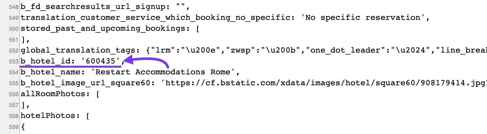
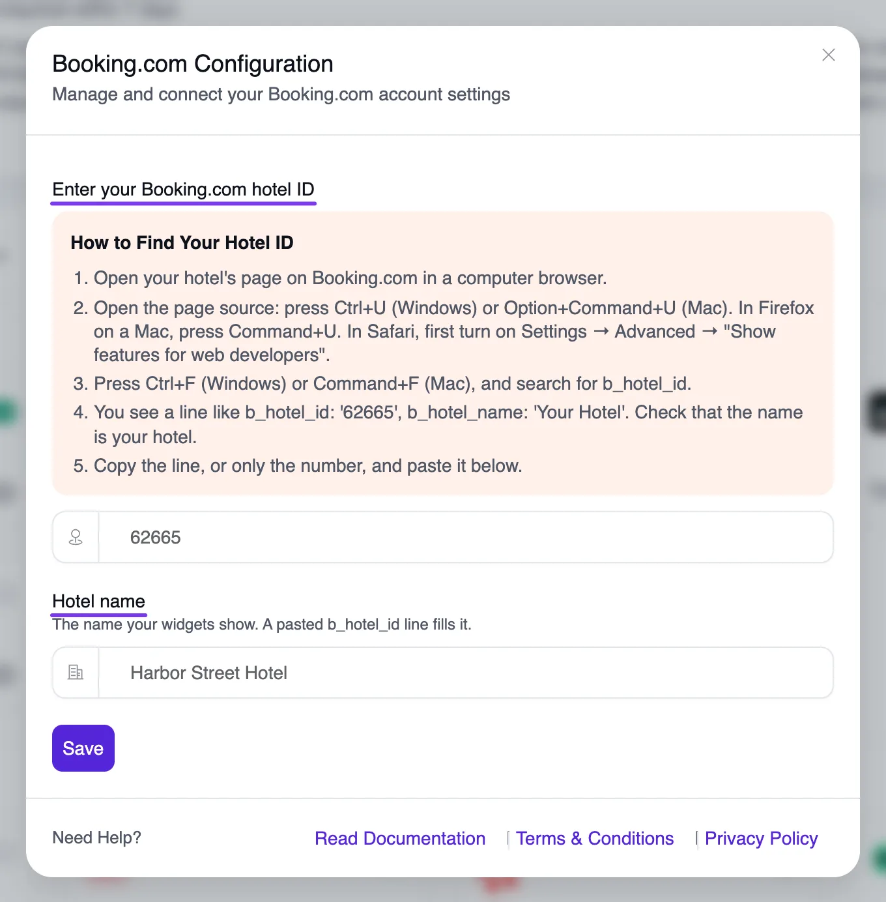
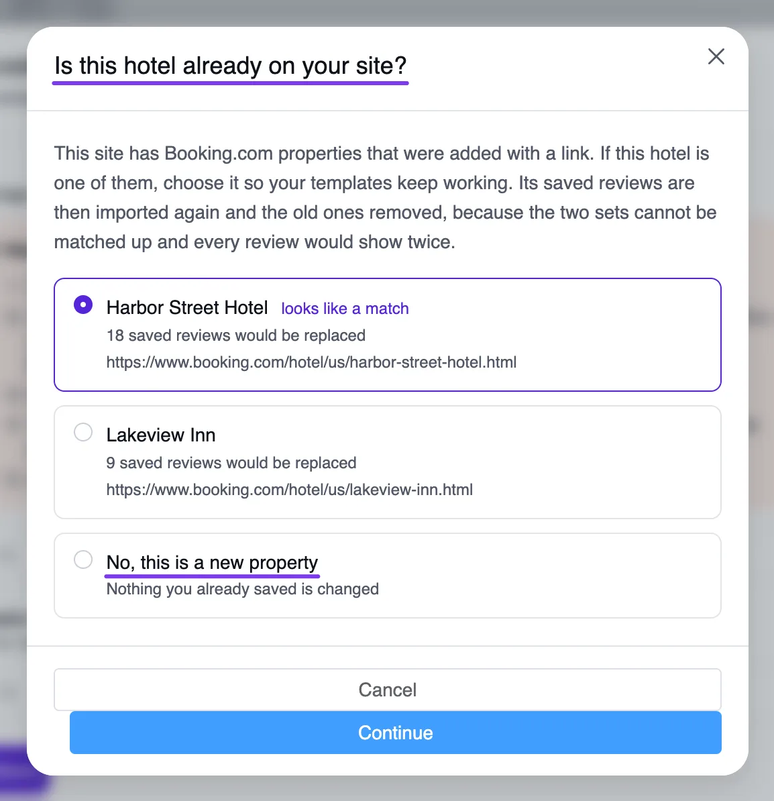

# Booking.com Reviews

WP Social Ninja enables you to showcase reviews directly from your Booking.com business profile, adding credibility to your business and enhancing trust among potential customers. With this feature, you can create customized templates to make your reviews look more appealing and aligned with your website's style.

In this guide, we’ll walk you through the steps to display Booking.com reviews on your website.

::: tip

You’ll need WP Social Ninja Pro to access and display Booking.com reviews on your site.

:::

## Enable Booking.com Platform

Navigate to your **WP Social Ninja** dashboard and select [Platform](../getting-started/all-platforms-of-wp-social-ninja) from the navigation bar. Locate the **Booking Platform** and click on the **Settings** icon to configure it.

## Find Your Hotel ID

WP Social Ninja connects to Booking.com with your hotel ID, a number that identifies your property. You no longer need a browser cookie or a code snippet. If you added the old **AWS-WAF-Token** snippet, you can remove it.

The **Booking.com Configuration** pop-up lists these same steps under **How to Find Your Hotel ID**:

1. Open your hotel's page on Booking.com in a computer browser.
2. Open the page source. Press **Ctrl+U** on Windows or **Option+Command+U** on a Mac. In Firefox on a Mac, press **Command+U**. In Safari, first turn on **Settings → Advanced → Show features for web developers**.
3. Press **Ctrl+F** on Windows or **Command+F** on a Mac, and search for `b_hotel_id`.
4. You'll see `b_hotel_id` with your hotel's number. The next line, `b_hotel_name`, shows the hotel's name. Check that the name is your hotel.
5. Copy both lines, or only the number.

## Connect Your Hotel

Now go back to the **Booking.com Configuration** pop-up:

1. Paste what you copied into **Enter your Booking.com hotel ID**.
2. Check **Hotel name**. This is the name your widgets show. If you pasted both lines, it should fill in for you. If it stays empty, type the name yourself.
3. Click **Save**.

### If You Added Properties With a Link Before

If your site has Booking.com properties that were added with a link, WP Social Ninja asks **Is this hotel already on your site?**

- **If this hotel is on the list:** Choose it so your templates keep working. Its saved reviews are imported again and the old ones are removed, so no review shows twice.
- **If it's a different hotel:** Choose **No, this is a new property**. Nothing you already saved is changed.

Then click **Continue**.

Once saved, you'll see that your business has been successfully added.

If you wish to add another business profile, simply click on the **Add More Business** button and repeat the same steps.

To customize your **Booking.com Reviews Template**, click on the **Add New Template** button and start personalizing your [template](./create-template). Keep in mind, if you don't create a template, your reviews won't be displayed, as the template won't be created automatically.

## How Booking.com Syncing Works

WP Social Ninja fetches your Booking.com reviews through its own service, so your WP Social Ninja Pro license needs to be active. Here's what to expect:

- **Up to 20 reviews per sync:** Each sync stores up to 20 reviews.
- **Every language:** Reviews are imported in all languages.
- **Weekly at most:** The shortest sync interval is **1 Week**. If you had a shorter interval, it moves to **1 Week** automatically.

You can find the sync setting under **WP Social Ninja → Settings → Reviews Platforms → Booking.com Settings**.

That's how you can easily fetch your **Booking.com** business profile reviews on your site using **WP Social Ninja**. 
