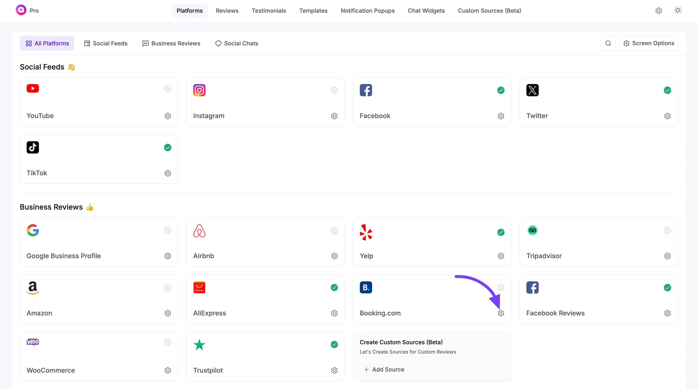
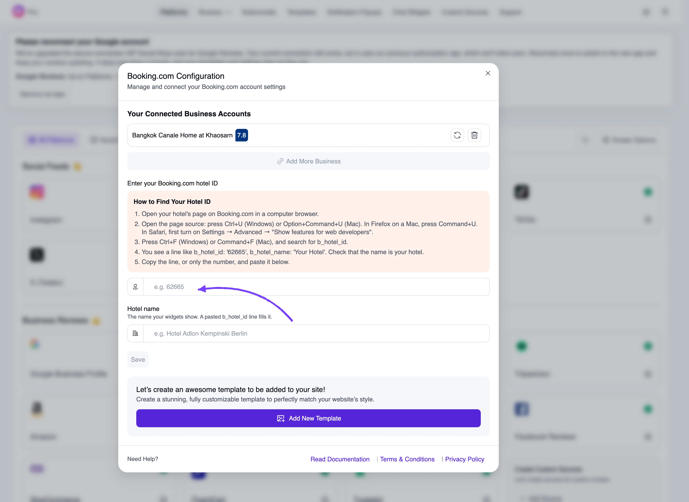
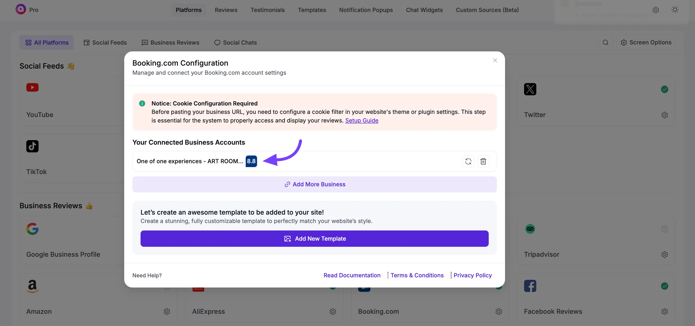

# Booking.com Reviews

WP Social Ninja enables you to showcase reviews directly from your Booking.com property, adding credibility to your business and enhancing trust among potential guests. With this feature, you can create customized templates to make your reviews look more appealing and aligned with your website's style.

In this guide, we'll walk you through connecting your hotel and displaying its Booking.com reviews on your website.

::: tip

You'll need WP Social Ninja Pro with an **active license** to access and display Booking.com reviews on your site.

:::

## **Enable Booking.com Platform**

Navigate to your **WP Social Ninja** dashboard and select [Platform](../getting-started/all-platforms-of-wp-social-ninja) from the navigation bar. Locate the **Booking Platform** and click on the **Settings** icon to configure it.

## **Connect Your Hotel**

You connect a property with its Booking.com hotel ID. You no longer need a cookie value or a code snippet. WP Social Ninja fetches Booking.com reviews through its own review service.

The **Booking.com Configuration** pop-up has two fields: **Enter your Booking.com hotel ID** and **Hotel name**.

### How to Find Your Hotel ID

1. Open your hotel's page on Booking.com in a computer browser.
2. Open the page source: press **Ctrl+U** (Windows) or **Option+Command+U** (Mac). In Firefox on a Mac, press **Command+U**. In Safari, first turn on **Settings → Advanced → "Show features for web developers"**.
3. Press **Ctrl+F** (Windows) or **Command+F** (Mac), and search for `b_hotel_id`.
4. You'll see a line like `b_hotel_id: '62665', b_hotel_name: 'Your Hotel'`. Check that the name is your hotel.
5. Copy the line, or only the number, and paste it into the **hotel ID** field.

If you paste the whole line, WP Social Ninja fills in the **Hotel name** field for you. Otherwise, type the name you want your widgets to show. Then click **Save**.

> [!NOTE]
> If you see **"No reviews found for Booking.com hotel ID …"**, double-check the number. It must be the `b_hotel_id` value from your own hotel's page.

### Is This Hotel Already on Your Site?

If you connected Booking.com properties in an earlier version of WP Social Ninja (using a page link), those properties can no longer get new reviews. You'll see a notice naming them on the Booking.com screen. Add each one again with its hotel ID, as described above.

When you save a hotel, WP Social Ninja asks **Is this hotel already on your site?** and lists your older properties, marking the one that **looks like a match**:

- **Choose the matching property** so your existing templates keep working. Its saved reviews are imported again and the old copies removed, because the old and new sets can't be matched up and every review would otherwise show twice. The list tells you how many saved reviews would be replaced.
- **Choose No, this is a new property** if it's a different hotel. Nothing you already saved is changed.

Click **Continue** to finish.

### Add More Properties

To connect another hotel, click the **Add More Business** button and repeat the same steps.

## **How Syncing Works**

- **Reviews in every language.** Booking.com reviews are imported in all the languages your guests wrote them in, not just English.
- **The latest 20 reviews per sync.** Each sync adds the 20 most recent reviews. Reviews already saved on your site are kept, so your collection grows over time.
- **A sync interval of at least 1 Week.** Under **Settings → Reviews Settings**, the shortest option offered for Booking.com is **1 Week**. If your connection was on a shorter schedule, it moves to 1 week automatically.

## **Create a Template**

To customize your **Booking.com Reviews Template**, click on the **Create a Template** button and start personalizing your [template](./create-template). Keep in mind, if you don't create a template, your reviews won't be displayed, as the template won't be created automatically.

That's how you can easily show your **Booking.com** reviews on your site using **WP Social Ninja**.
