# Creating a Review Template

This is one of the most important and powerful features of WP Social Ninja. The Review Template is where you design and control everything about how your reviews look and function.

This guide will walk you through the entire process, starting with how to create your first template, and then providing a detailed explanation of every single setting you have available.

## Part 1: How to Create Your Review Template

First, let's create the template itself.

1.  From your WordPress dashboard, navigate to **WP Social Ninja → Templates**.
2.  On this page, click the **+ Add New Template** button.
3.  In the **Template Type** dropdown, choose **Review Template**.
4.  Give your template a name you'll remember (e.g., "Main Website Reviews" or "5-Star Homepage Slider").
5.  Click **Create Template**.

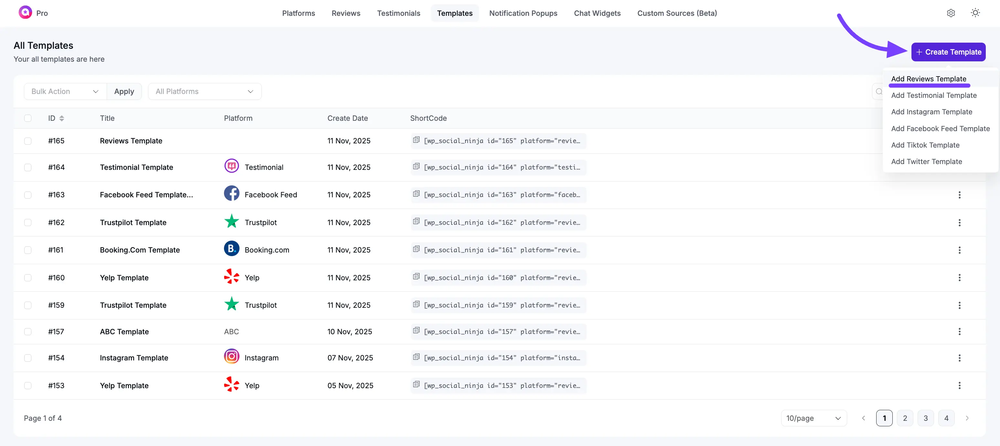

You will now be taken to the main **Template Editor**. This is where you will set up every detail of your new review feed. The editor is organized into two main tabs: **General** and **Style**.

This guide covers every setting in the **General** tab.

## Part 2: Customizing Your Template (General Settings)

The **General** tab controls *what* content is shown (your platforms, filters, and text) and *how* the feed functions (the layout, buttons, and pagination).

Here is a breakdown of each section:

### 1. Platforms

This is the most important step. It controls which reviews you want to display in this template.

* **Select Platforms:** This is a list of all the review sources you have connected to WP Social Ninja. You can select one or multiple platforms.

> **Use Case:** This is what makes WP Social Ninja so powerful. You can check the box for **Google**, **Facebook**, and **Yelp** all at the same time to create a single, unified feed of all your best reviews from every platform.

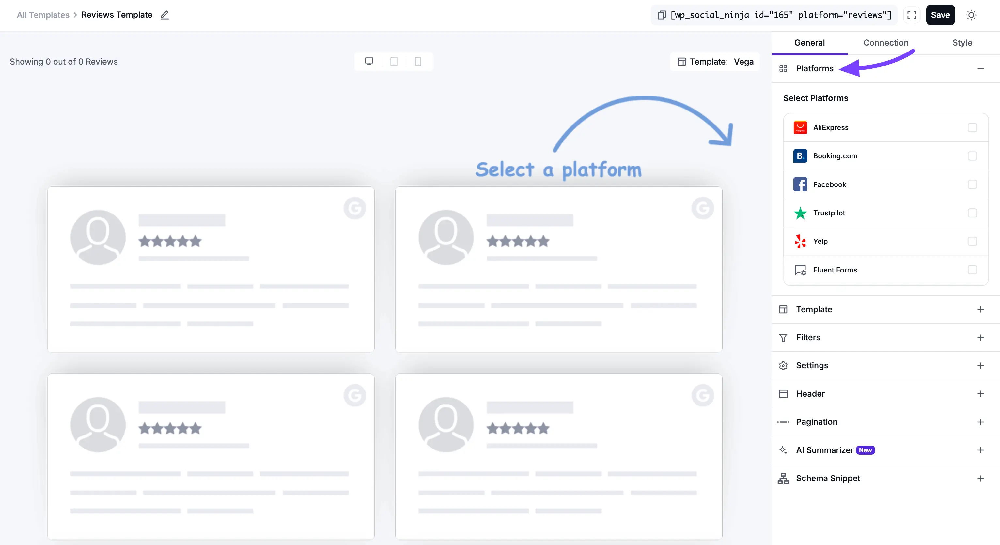

### 2. Template

This section controls the visual structure and arrangement of your reviews.

* **Layout Type:** This is the foundational structure of your feed.
    * **Grid:** Creates a clean, organized, multi-column grid. All review boxes are forced to be the same height, which creates a very neat and symmetrical look.
    * **Slider:** Displays your reviews in a horizontal, swipe-able carousel. This is perfect for saving space on a homepage.
    * **Masonry:** A "Pinterest-style" grid where boxes have different heights based on their review text, fitting together like bricks.
    * **Badge:** A small, compact layout that is often used to show a summary of your rating (e.Example, "4.9 out of 5 stars").
    * **Feature Grid:** *(Pro)* Shows one large featured review beside smaller review cards.
    * **Score Slider:** *(Pro)* Puts your overall rating and the **Write a Review** button in a column on the left, with a review slider beside it. Keep the **Header** turned on, because the left column comes from it. This layout isn't available when your template uses testimonials.
    * **Marquee:** *(Pro)* Scrolls your reviews continuously, with a pause button for visitors. You can adjust the **Scroll Speed** and **Card Width**.

    Click **See All** to see every layout type.
* **Select a Template:** These are pre-designed visual "skins" for your feed (e.g., Vega, Spica, Sirius). Each one changes the styling of the review boxes, fonts, and layout. When you use the **Badge** layout, these *(Pro)* skins are also available:
    * **Badge3:** A small card with your score, plus an avatar stack of reviewer photos when your reviews have them.
    * **Badge4:** A wide score strip with your rating label, stars, and review count.
    * **Badge5:** A circle sticker with your score in the center.
    * **Badge6:** A rounded-square sticker with your score in the center.
* **Number of Columns:** This is a crucial responsive setting. You can set the number of columns you want to show on **Desktops**, **Tablets**, and **Mobile** phones.

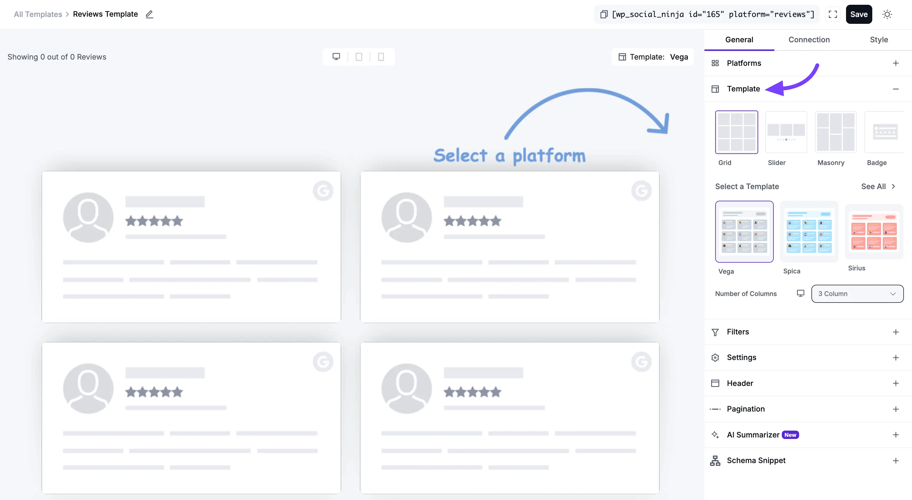

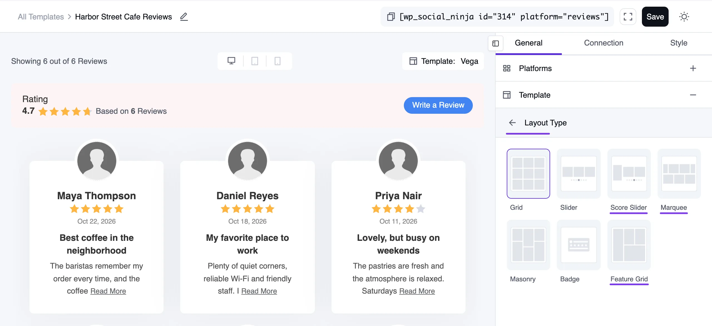

#### What the New Layouts Look Like

Here's how the *(Pro)* layouts and badges look, using sample reviews for a demo cafe.

* **Feature Grid:** One large review sits beside smaller cards, so a standout review gets the most attention.

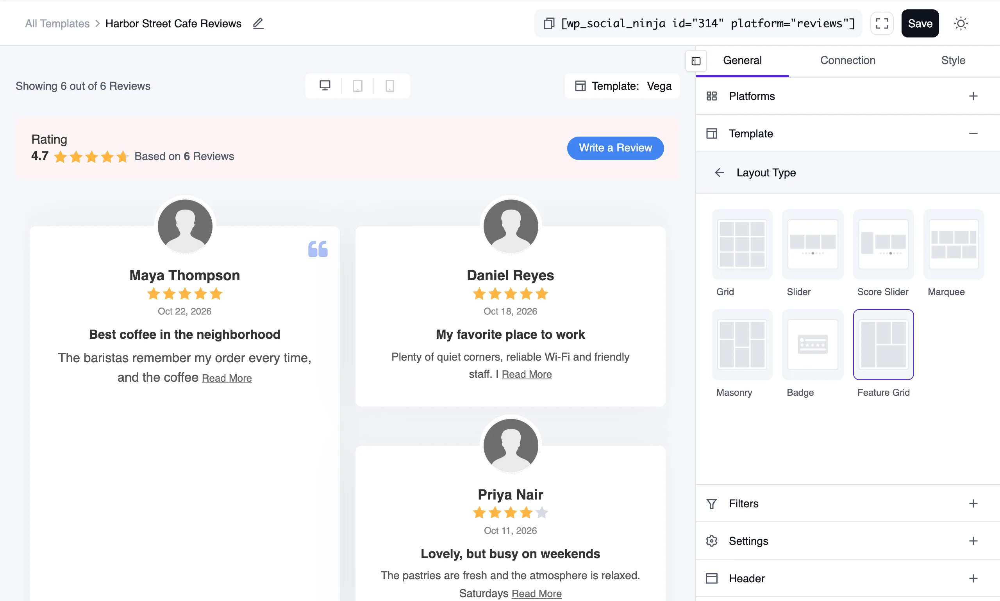

* **Score Slider:** Your rating stays in view on the left while visitors move through your reviews.

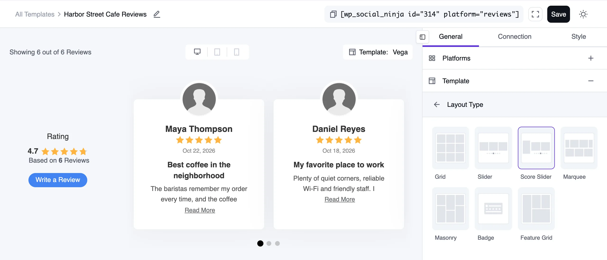

* **Marquee:** Rows of reviews scroll across the page and fade at the edges.

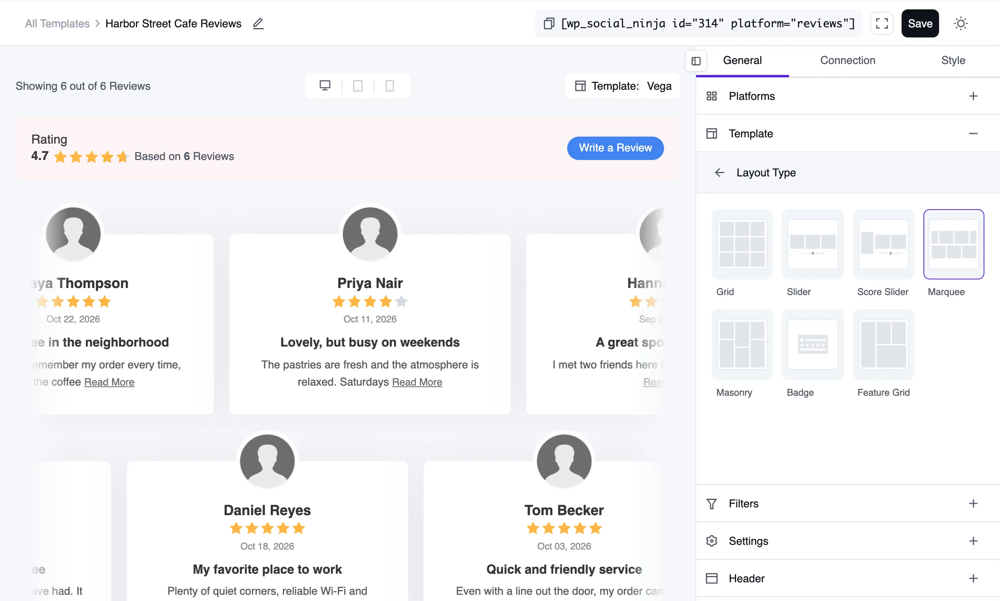

* **Badges:** Pick the size and shape that suits the space you have. These demo reviews have no reviewer photos, so **Badge3** shows no avatars here.

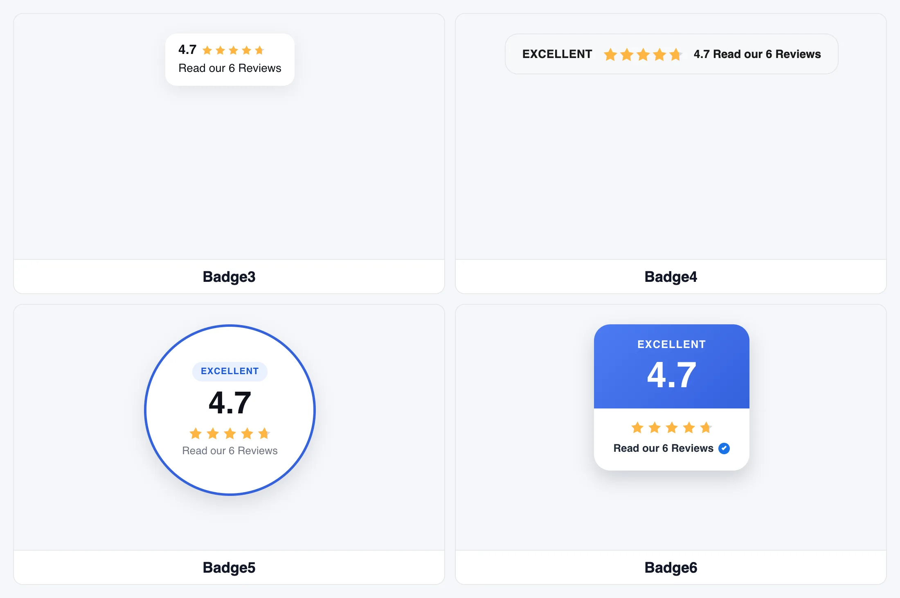

### 3. Filters

Filters are how you refine your feed to only show the specific reviews you want.

* **Number of Reviews:** Sets the total number of reviews that will be loaded into this template.
* **Filters by Minimum Rating:** This is a very powerful filter. You can use this to show only your best reviews.
    > **Example:** If you select "5 Stars," this template will only display reviews that have a 5-star rating, creating a "Best Of" showcase.
* **Order:** This lets you sort your reviews.
    * **Descending:** Shows newest reviews first (most common).
    * **Ascending:** Shows oldest reviews first.
* **Hide Reviews Without Text:** A simple On/Off toggle. If turned **On**, it will hide any reviews that have a star rating but no written text, ensuring every item in your feed has content.
* **Filter by Include/Exclude:** This gives you precise, manual control. You can search for and select specific reviews to either **Include** (show only these) or **Exclude** (show all except these).
* **Show/Hide reviews containing these words:** These are moderation tools.
    > **Use Case:** You could use "Show" to create a feed that only mentions "customer service." Or, you could use "Hide" to filter out any reviews that mention a "bug" or "shipping problem."
* **Filter by Business/Product:** (For WooCommerce/Custom Reviews) This lets you show reviews associated with only one specific product.
* **Filter by Category:** (For WooCommerce/Custom Reviews) This lets you show reviews only from a specific product category (e.g., "Shoes").
* **Let Visitors Search, Sort & Filter:** *(Pro)* Adds a search box and sort and rating dropdowns above your feed, so visitors can narrow it down themselves. See [Let Visitors Search, Sort & Filter Reviews](/guide/business-reviews/visitor-search-sort-filter).

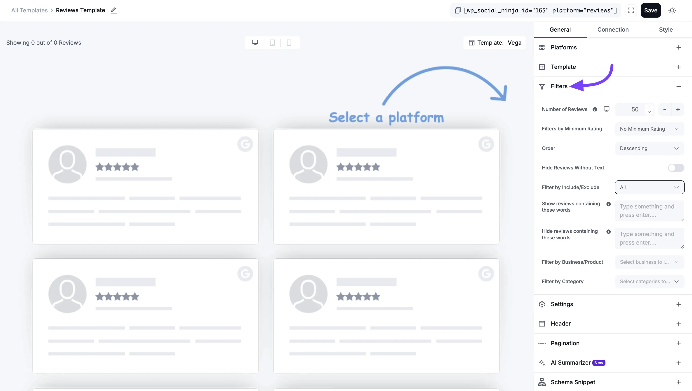

### 4. Settings (Content Display)

This section controls which pieces of information you want to display inside each individual review card.

* **Display Rating:** A simple On/Off toggle to show or hide the star rating (e.g., ★★★★★).
* **Display Verified Badge:** A toggle to show or hide a "Verified" badge, which adds extra trust.
* **Rating Style:** This lets you choose the visual style for the stars.
* **Display Date:** A toggle to show or hide the date the review was posted.
* **Display Reviewer Name:** A toggle to show or hide the person's name (e.g., "John Doe").
* **Reviewer Name Format:** Lets you choose whether to display the reviewer's **Full Name** or just their **First Name** (which is a good option for privacy).
* **Display Reviewer Image:** A toggle to show or hide the reviewer's profile picture.
* **Display Platform Icon:** A toggle to show or hide the icon of the source platform (e.g., the Google, Facebook, or Yelp logo). This is great for a mixed-platform feed.
* **Display Review Title:** A toggle to show or hide the main "title" or "headline" of the review.
* **Display Review Text:** A toggle to show or hide the main body of the review text.
* **Content Type:** This lets you choose what to display for the main text:
    * **Full Content:** Shows the entire review text, no matter how long.
    * **Excerpt:** Lets you show a short "snippet" of the text.
* **Trim Excerpt Words:** This setting only appears if you select "Excerpt." It lets you set the exact number of words (e.g., 25) to show before the text is cut off. This is the key to creating a clean, uniform look for your grid or slider.
* **Enable External Links:** A toggle to allow any links in the review text to be clickable.
* **Show Review Images:** A toggle to show or hide photos that reviewers attached to their reviews.
* **Equal Height:** This toggle is essential for the **Grid** layout. When toggled **on**, all review boxes are forced to the same height (based on the tallest one), creating a perfect, uniform grid. You should turn this **Off** if you are using the **Masonry** layout.

::: info Why you might not see "Show Review Images"
This toggle only appears when your template includes a platform that can actually collect photos with a review:

- [Native review forms](/guide/business-reviews/native-review-forms)
- [WooCommerce](/guide/business-reviews/woocommerce-reviews)
- [FluentCart](/guide/business-reviews/fluentcart-product-review)
- [Fluent Forms](/guide/business-reviews/fluent-forms-review)
- [Testimonials](/guide/advanced-features/add-testimonials)

Google, Facebook, Yelp, Airbnb, Trustpilot, Tripadvisor, Booking.com, AliExpress, Amazon and manually added custom reviews don't come with reviewer photos, so on a template built only from those the toggle is hidden rather than shown as a switch that would do nothing.
:::

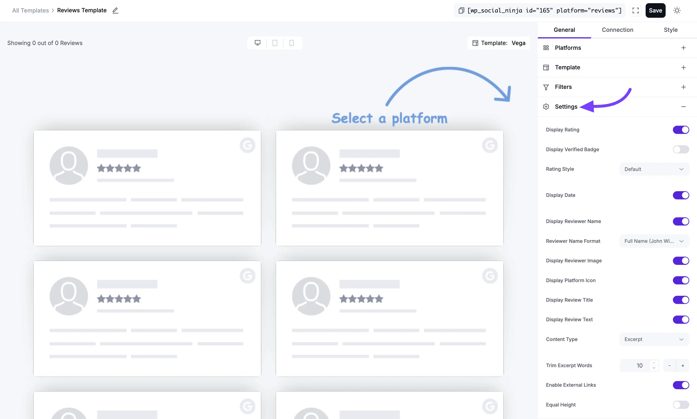

### 5. Header

This section controls the large box that appears at the top of your entire feed, summarizing your reviews.

* **Display Header:** This is the master On/Off switch for the entire header section.
* **Header Template:** These are pre-designed visual "skins" for the header box itself.
* **Display Logo:** A toggle to show or hide your main business logo.
* **Display Title:** A toggle to show or hide the header's title (e.g., "Customer Reviews").
* **Display Rating:** A toggle to show or hide your aggregate (average) star rating (e.g., "4.9 out of 5").
* **Display Number of Reviews:** A toggle to show or hide the total number of reviews.
* **Display Write a Review Button:** This is a powerful Call to Action (CTA). It adds a button to your header to encourage your site visitors to leave a review.
* **Custom Title Text:** Lets you change the default "Reviews" text to anything you want (e.g., "What Our Customers Say").
* **Custom Number of Reviews Text:** Lets you customize the text (e.g., "Based on {total} reviews").
* **Custom Button Text:** Lets you change the "Write a Review" button text (e.g., "Leave Your Feedback!").

#### Add "Write a Review" URL?

* **Button Source Type:** This lets you decide what the button does.
    * **Custom URL:** The most common option. You can paste a link directly to your Google, Facebook, or Yelp review page, making it easy for customers.
* **Open in new window:** (Recommended) Check this to open the review link in a new browser tab.

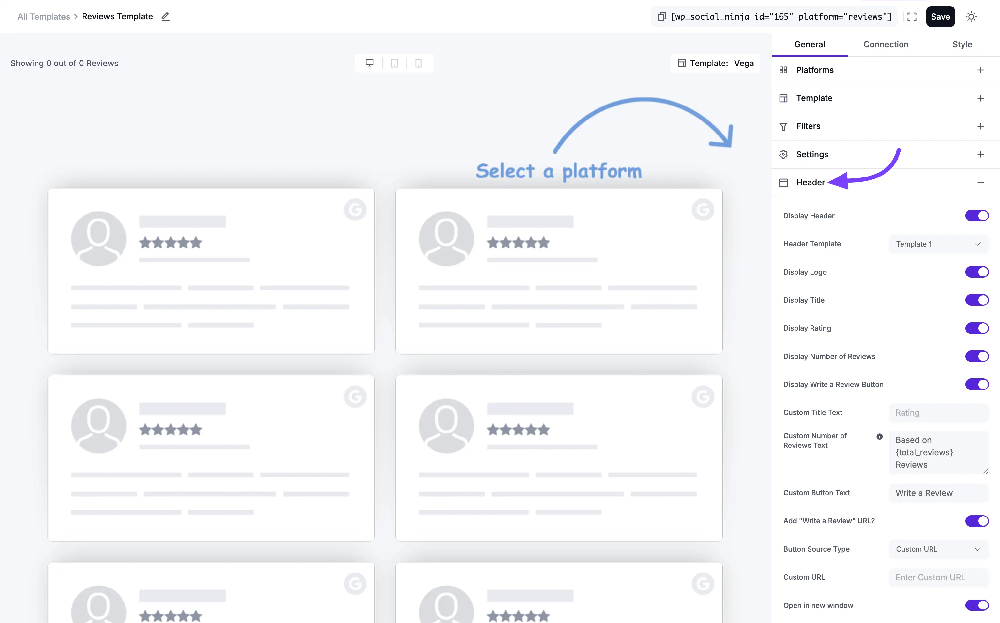

### 6. Pagination

This controls what happens when a visitor gets to the bottom of the initial set of reviews.

* **Pagination Type:**
    * **None:** The feed will only show the "Number of Reviews" (from the **Filters** section) and that's it. There will be no way to load more.
    * **Load More:** This will add a button at the bottom of your feed. When clicked, it will load the next set of reviews. This is the most popular option.
* **Load More Button Text:** You can change the text from "Load More" to something like "Show More Reviews" or "See More."
* **Reviews Per Page:** This is very important. This number controls how many *new* reviews are loaded *each time* the "Load More" button is clicked.

> **Example:** You might set your feed to show 10 reviews at first, and then set 5 "Reviews Per Page." When a user clicks "Load More," 5 new reviews will appear (for a total of 15).

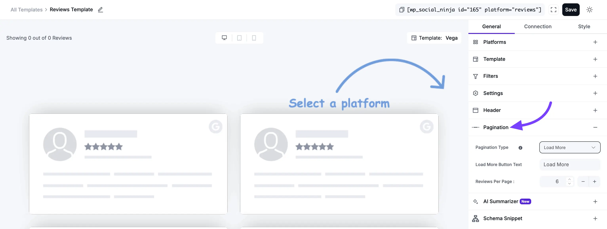

### 7. AI Summarizer

This is a powerful "New" feature that uses AI to analyze your reviews and provide a summary for your visitors. You can power it with [WordPress AI](../ai-integration/wordpress-ai-integration-for-review), [OpenAI](../ai-integration/openai-integration-for-review), or [OpenRouter](../ai-integration/openrouter-integration-for-review).

* **Display AI Summary:** The main On/Off toggle for the feature.
* **Summary Style:** Choose a visual style for the summary box.
* **Display Read More:** A toggle to add a "Read More" link if the summary is long.
* **Text Typing Animation:** A toggle to enable a "typing" effect for the summary text, which makes it very eye-catching.
* **Display AI Summary Icon:** A toggle to show or hide a small AI icon.
* **Regenerate AI Summary:** This is a key button. If you don't like the summary the AI generated, or if you have a lot of new reviews, you can click this to force the AI to write a new one.

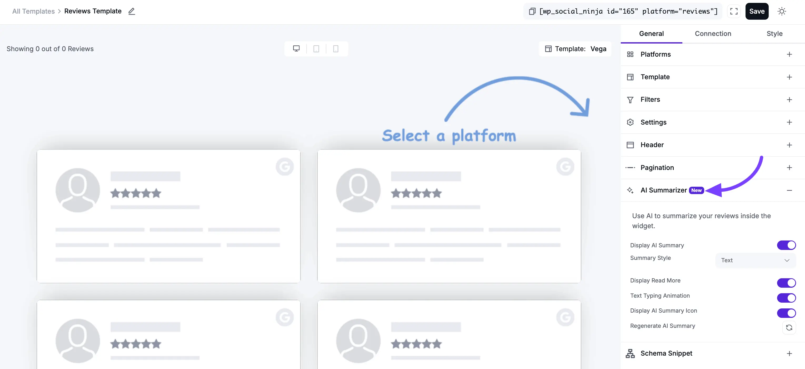

### 8. Schema.org Markup

This is a crucial and highly technical feature for SEO (Search Engine Optimization).

* **What it does:** When enabled, this adds special, invisible code (called JSON-LD schema) to your page. This code helps Google understand that you have reviews on your page.
* **Why it's important:** This is the feature that helps you get gold review stars (rich snippets) to appear next to your website in Google search results, which can dramatically increase your click-through rate.

#### Configuration Options

* **Enable Schema.org Markup:** The main On/Off toggle. You should almost always keep this **On**.

> **Note:** You may test if your schema snippet is valid or not by using Google's **Rich Results Test** tool.

* **Schema Type:** Select the classification that best describes your content.
   * **Aggregate Rating:** Use this for general business ratings (e.g., LocalBusiness, Restaurant).
   * **Product with Reviews:** Select this to add detailed product information alongside individual reviews for richer search results.

* **Business Logo:** Provide your official **Business Name**, **Business Phone Number**, and upload a **Business Logo**. These details ensure search engines associate the reviews with the correct entity.
* **Business Name:** Choose the most accurate category from the dropdown menu to help search engines categorize your business correctly.
* **Business Type:** This is very important. Select the type that best fits your business from the list (e.g., "LocalBusiness," "Restaurant," "Product").
* **Business Phone Number:** Add your main business phone number.
* **Business Description:** (Available for "Product with Reviews") Enter a concise summary of the product or service being reviewed.
* **Include Business Address:** A toggle to include your physical location data in the structured code.

#### Moderation and Fallbacks

 * **Fallback Average Rating:** Enter a backup rating (e.g., 4.5) to be used if the system cannot dynamically fetch your live rating.
 * **Fallback Total Rating:** Set a default number of reviews to ensure the schema remains valid even if live data is temporarily unavailable.
 * **Number of Reviews to Include:** (Available for "Product with Reviews") Define exactly how many individual reviews should be included in the structured data.

>[!Tip]
>You can verify that your configuration is working correctly by using [Google's Rich Results Test](https://search.google.com/test/rich-results) tool. Simply paste your page URL to see if your review stars are ready for search results.

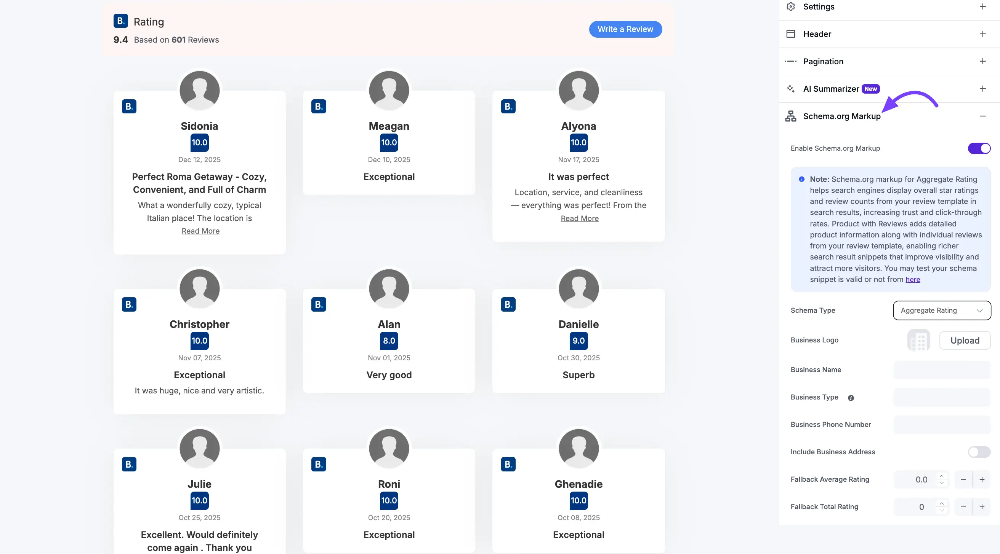

## Part 3: Next Steps

Congratulations! You have now configured every single content and function setting for your review template.

Your next steps are:

* Click on the **Style** tab at the top of the editor to customize all the colors, fonts, borders, and spacing to perfectly match your brand.
* Click the **Save Template** button at the bottom.
* Copy the shortcode for your new template and paste it onto any page, post, or widget area on your site to make your new review feed go live!