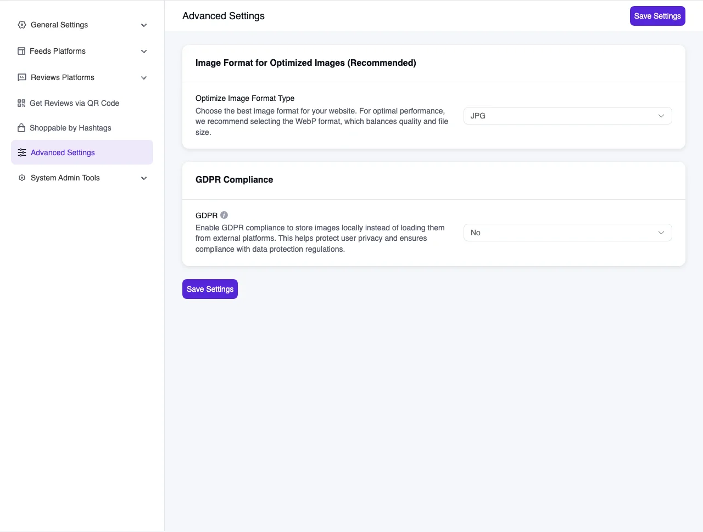

# Advanced Settings

This guide will walk you through all the options on the **Advanced Settings** page. This is the main control center for your entire WP Social Ninja plugin, allowing you to manage global performance (Image Format), privacy (GDPR), and where to find your data tools.

You can find this page by navigating to:

**WP Social Ninja → Settings → Advanced Settings**

## Settings

Here is a detailed explanation of each feature on this page.

### 1. Image Format for Optimized Images (Recommended)

This section controls how the plugin handles images from all your feeds and reviews to make your site load faster.

**Optimize Image Format Type**

* **What it is:** This is a powerful performance feature. It lets you choose the file format that WP Social Ninja will use to save optimized copies of your images (like Instagram photos, Google review avatars, etc.).
* **How it works:** When the plugin fetches an image, it will automatically convert it to the format you select here and save it on your own server. This process (especially with **WebP**) creates much smaller image files, which makes your entire website load significantly faster for your visitors.
* **Our Recommendation:** We strongly recommend selecting the **WebP** format. This is a modern image format created by Google that provides the best balance of high image quality and incredibly small file sizes.

### 2. GDPR Compliance

This section provides a simple but powerful tool to help you comply with the GDPR (General Data Protection Regulation), a European privacy law.

**GDPR (Toggle)**

* **What it is:** This is your main privacy switch.
* **How it works:** When you turn this toggle **On**, the plugin will change its behavior to better protect your users' privacy. Instead of loading images directly from external platforms (like Facebook, Google, or Instagram), the plugin will first save copies of those images locally to your own website's server.
* **Why this is important:** This means your visitors' browsers won't have to connect to those external sites just to see an image. This helps you comply with data protection rules by preventing the automatic sharing of a user's data (like their IP address) with those third-party platforms.

### 3. Manage Data (Moved)

The **Delete all Platform Data?** button used to live on this page. As of version 4.5.1 it has moved to **WP Social Ninja → Settings → System Admin Tools → Data Cleanup**. It works exactly the same way, along with a few new health tools. Learn more in the [System Admin Tools guide](./system-admin-tools#data-cleanup).

