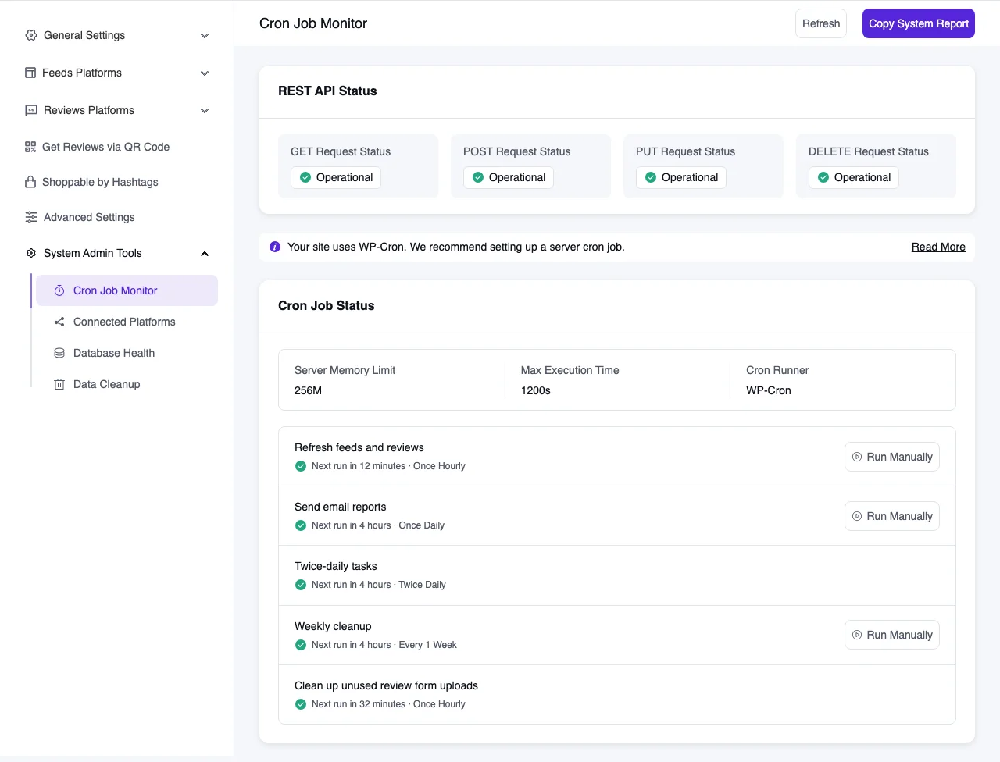
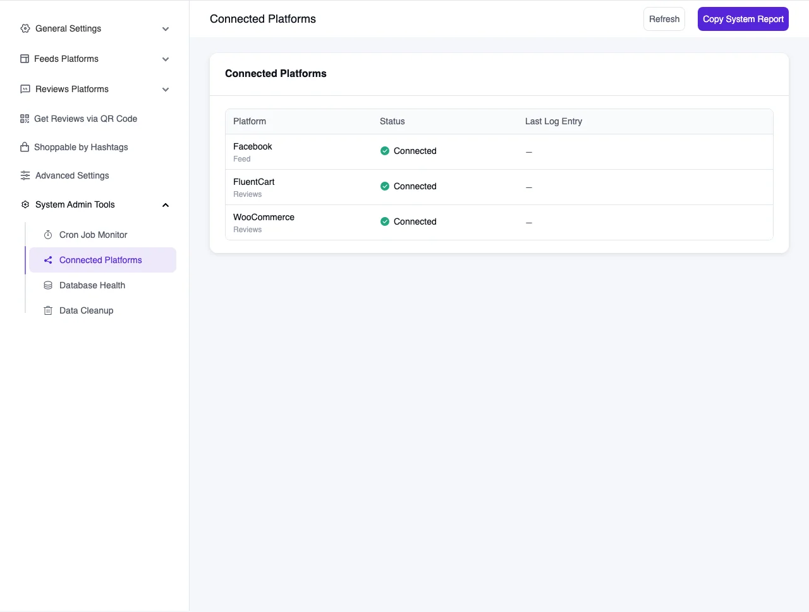
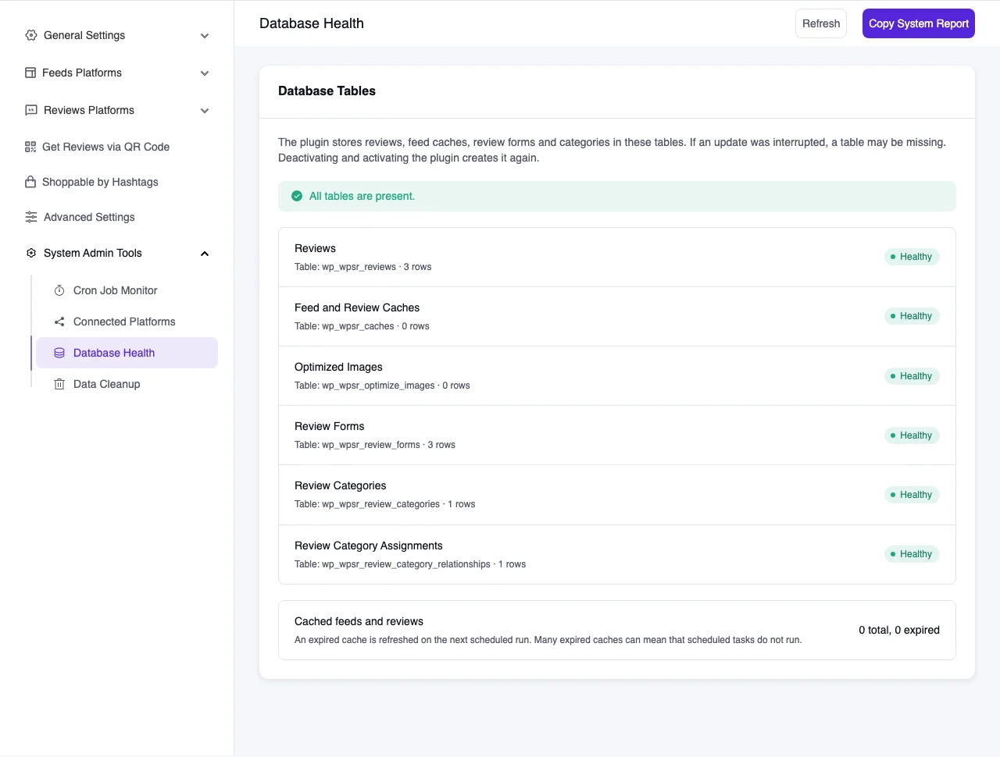
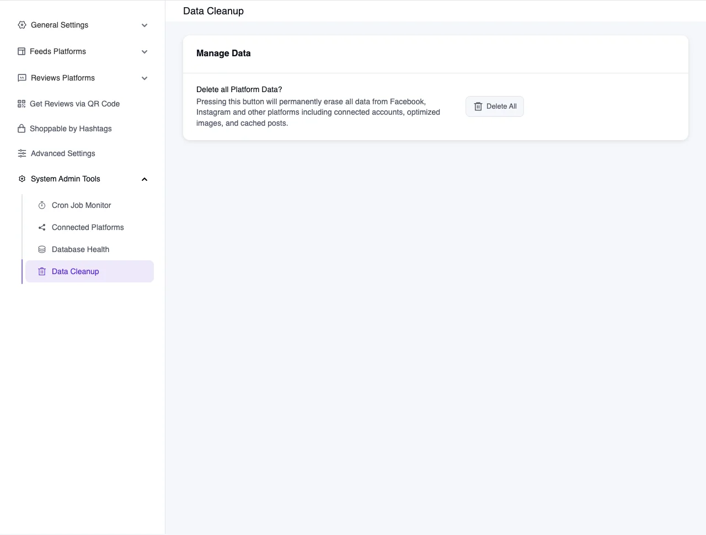

# System Admin Tools

When feeds stop updating or a platform acts up, the quickest way to find out why is to look under the hood. **System Admin Tools** gives you four simple health pages in one place, so you can spot a problem (and often fix it) without touching any code or asking your host.

To open them, go to **WP Social Ninja → Settings** and click **System Admin Tools** in the left menu. You'll see four pages:

* **Cron Job Monitor**
* **Connected Platforms**
* **Database Health**
* **Data Cleanup**

> [!NOTE]
> These pages show technical details about your site, so they are available to users with full access to WP Social Ninja. Actions such as **Run Manually** also require a WordPress administrator.

## Cron Job Monitor

WP Social Ninja relies on scheduled tasks (cron jobs) to refresh your feeds and reviews, send email reports and tidy up old data. This page shows whether those tasks are healthy.

### REST API Status

At the top, four cards confirm that your site's REST API answers **GET**, **POST**, **PUT** and **DELETE** requests. The plugin's admin screens need all four, so each should say **Operational**. If one doesn't, a security plugin or server rule is probably blocking that request type.

### Cron Job Status

Below that you'll find:

* **Server Memory Limit** and **Max Execution Time:** the PHP limits your server gives to background tasks. Very low values can stop large feeds from finishing.
* **Cron Runner:** how your cron jobs are triggered, either **WP-Cron** (WordPress's built-in method) or **Server cron**. If your site uses WP-Cron, you'll see a tip recommending a real server cron job, which is more reliable on quiet sites.
* **Task list:** every scheduled task, such as **Refresh feeds and reviews**, **Send email reports**, **Twice-daily tasks** and **Weekly cleanup**. Each shows its status, when it runs next and how often. A task that is missing from the schedule shows **Not scheduled** so you can spot it quickly.

### Run a Task Manually

Don't want to wait for the next run? Click **Run Manually** beside a task (for example, **Refresh feeds and reviews**) to run it right now. This is handy after fixing a connection problem.

### Refresh and Copy System Report

* **Refresh** reloads the latest status.
* **Copy System Report** copies a summary of your site's health to the clipboard. Paste it into a message to our [support team](https://wpmanageninja.com/support-tickets/) to get help faster.

## Connected Platforms

This page lists every platform you've connected, so you can see at a glance which ones are working.

For each platform you'll see:

* **Platform:** its name and whether it is a **Feed** or **Reviews** platform.
* **Status:** **Connected**, or a warning or error if the connection has problems.
* **Last Log Entry:** the most recent error the plugin recorded for that platform, if any. A dash means there's nothing to report.

If a platform shows an error, reconnect it from **WP Social Ninja → Platforms**. Our [connecting your accounts guide](../getting-started/connecting-your-accounts) walks you through it.

## Database Health

WP Social Ninja stores reviews, feed caches, review forms and categories in its own database tables. This page checks that each one exists.

* A green **All tables are present** message means everything is in place.
* Each table (such as **Reviews**, **Feed and Review Caches** and **Optimized Images**) shows its name, its row count and a **Healthy** badge.
* **Cached feeds and reviews** shows how many caches you have and how many have expired. An expired cache is refreshed on the next scheduled run, so a large number of expired caches can mean your scheduled tasks aren't running. Check the [Cron Job Monitor](#cron-job-monitor) if that happens.

If a table is missing (for example after an interrupted update), deactivate and then reactivate the plugin. It will create the table again.

## Data Cleanup

This page holds the **Manage Data** tool that used to be in [Advanced Settings](./advanced-settings).

**Delete all Platform Data?** permanently erases all data from Facebook, Instagram and your other platforms. This includes connected accounts, optimized images and cached posts.

> [!WARNING]
> This action is permanent and cannot be undone. You will need to reconnect every platform afterwards. Only use it if you want to start fresh or are removing the plugin for good, ideally after talking to our support team.

If you have any questions or need further assistance, feel free to reach out to our [support team](https://wpmanageninja.com/support-tickets/).
