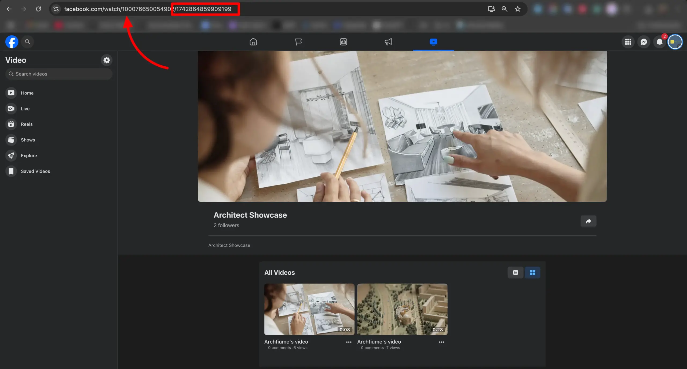
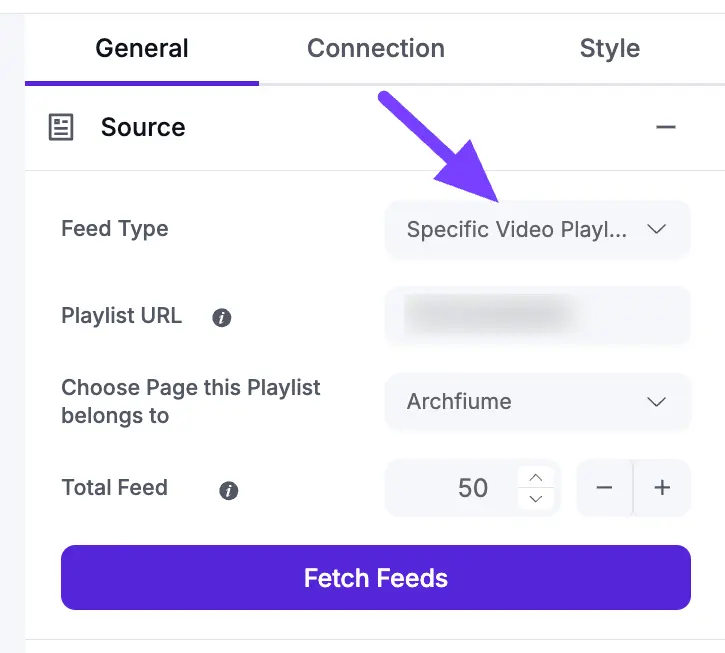

# Facebook Specific Video Playlist Feed

If you want to display a Specific Video Playlist on your website, WP Social Ninja makes it simple. In this guide, we’ll walk you through the steps to add a Specific Video Playlist to your site.

## **Get the Playlist ID**

To display a specific video playlist from Facebook on your site using WP Social Ninja, you'll need the playlist's ID or URL. First, go to your Facebook Page's video playlist section and open the playlist you want to add. Once it's open, copy the URL or Playlist ID from the address bar for later use.

## **Add Specific Video Playlist**

To add a Video Playlist, first connect your Facebook **Page** to WP Social Ninja. Then, click the **Add New Template** button to create a new template.

To learn how to connect your Facebook Page, follow the step-by-step instructions in this [article](./facebook-integration).

From the template settings, go to the **General** section of the Facebook Template, then click on the **Source** option.

**Feed Type:** Select **Specific Video Playlist** from the dropdown menu.

**Album ID/URL:** Enter the Playlist URL or just the Playlist ID here that you have copied earlier.

**Choose Page This Playlist Belongs To:** Pick the Facebook Page the Playlist is linked to from the dropdown list.

**Total Feed:** Set the number of items you want to display in your template.

Now, click the **Fetch Feeds** button, and your Playlist will be loaded into the template.

You’ll also find additional settings and styling options to customize your Specific Video Playlist template. Once you're done, click the **Save Template** button to save your changes.

## When Facebook Won't Share a Playlist

Sometimes the feed shows a message saying Facebook couldn't load the playlist. This happens with playlists created in Facebook's **Professional Dashboard**: they hold Reels, and Facebook doesn't share those playlists with apps like WP Social Ninja, so it isn't something wrong with your connection.

Here's the simple workaround:

1. In the template's **Source** section, set **Feed Type** to **All Videos**.
2. Open the **Filters** section.
3. In **Show Only These Posts** *(Pro)*, paste the link of each reel or video from your playlist, separated by commas.
4. Click **Fetch Feeds**.

Your feed will now show just the videos you listed. Learn more about this filter in the [Facebook customization guide](./facebook-customization).

## Videos That Can't Be Played on Your Site

Facebook does not allow every video to be embedded on another website. Reels, videos with certain privacy or rights settings, and some live recordings are marked as non-embeddable.

When WP Social Ninja meets one of these, it shows the video's thumbnail with a **View on Facebook** link instead of an empty player. Visitors can still get to the video in one click, and your feed does not show a broken box.

::: tip
You can change the wording of that link under **Settings → Translation**, if "View on Facebook" doesn't suit your site's tone.
:::

If you have any further questions or need assistance, please don’t hesitate to contact [us](https://wpmanageninja.com/support-tickets/).
